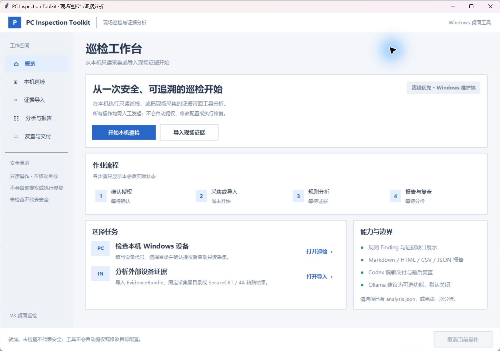
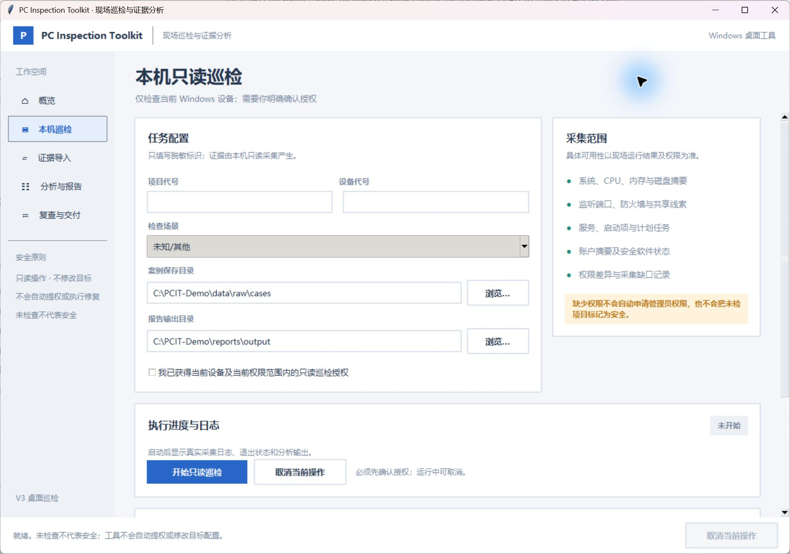
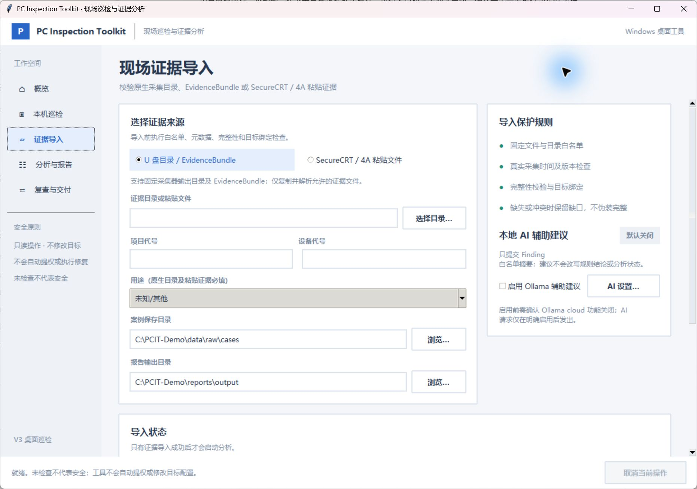

# PC Inspection Toolkit

[简体中文](README.zh-CN.md)

**0.3.0 Preview · source checkout**

PC Inspection Toolkit is a read-only inspection and offline evidence-analysis tool for authorized maintenance work. It presents collected facts, deterministic findings, evidence gaps, and human review steps. It does not automatically remediate systems or elevate privileges.

The desktop GUI is in Chinese.

## Preview screens

These screenshots show the real Windows desktop application. Paths shown are synthetic examples.







## Current source capabilities

- A Chinese Windows desktop guide for explicitly authorized, current-PC read-only collection and evidence import. The desktop GUI is developed and validated on Windows; this is not a clean-machine or administrator acceptance claim.
- Import and offline analysis of validated Windows and POSIX evidence bundles, with explicit `OK`, `PARTIAL`, or `FAILED` status.
- POSIX shell collection and SecureCRT / 4A paste import for an already authorized session. The tool does not connect to those targets itself.
- HTML, Markdown, CSV, and JSON reports; analysis comparison and redacted Codex export.
- Manual web-AI v2 export and structured-response import. The user controls any upload; the toolkit does not send web-AI requests.
- Experimental, opt-in local Ollama advisory analysis. It is off by default. Suggestions are separate from deterministic findings and do not change findings, severity, or status; recommendation quality has not been accepted as reliable.

## Platform and verification limits

The desktop GUI has been exercised on Windows 11. This preview's launch walkthrough used Python 3.12.10 and Tk 8.6.15; the screenshots use synthetic paths and the walkthrough did not collect computer data. Python 3.10 or later with Tkinter is the documented minimum, but every Python/Tk combination and clean-machine setup has not been tested. Real local collection, clean Windows installation, ordinary-versus-administrator coverage, and broad hardware coverage have not been accepted. The CLI includes Windows and POSIX collection branches; that does not establish support for every Linux distribution, legacy server, or macOS version. POSIX collectors and paste workflows require an already authorized operator session. AIX, Windows Server 2008, RHEL 5/6, real 4A environments, SMART/RAID and vendor-specific hardware checks remain unverified. The tool cannot guarantee that every security or maintenance issue will be found.

`PARTIAL` and `FAILED` are not successful inspections. Missing or inaccessible evidence remains unknown or incomplete; it is not reported as healthy.

## Quick start from source

Clone the public source and enter the checkout:

```powershell
git clone https://github.com/yge-323/pc-inspection-toolkit-public.git pc-inspection-toolkit-public
Set-Location .\pc-inspection-toolkit-public
```

Prepare Git and Python 3.10 or later from your usual trusted source; choose a Python distribution that includes Tkinter. The GUI and CLI help need no additional `pip` packages.

The Windows desktop GUI requires Python 3.10 or later with Tkinter. Check Python and Tkinter before launch:

```powershell
python --version
python -c "import tkinter as tk; root=tk.Tk(); print('Tk', root.tk.call('info','patchlevel')); root.destroy()"
```

Start the Chinese desktop guide. Opening it does not start collection:

```powershell
python -B .\desktop_launcher.py
```

## Safe first experience

1. Start the GUI above and browse **概览**, **本机巡检**, and **证据导入**.
2. Leave authorization unchecked. Do not start collection or select/import evidence during this first tour; close the GUI when finished.
3. Then inspect the advanced CLI help. This displays usage only and does not collect or analyze evidence.

```powershell
python -X utf8 -B .\inspection_cli.py --help
```

On Windows, use Python's UTF-8 mode (`-X utf8`) when redirecting CLI output, and read the redirected output as UTF-8. See the [recorded preview walkthrough](docs/PREVIEW_WALKTHROUGH.md) for the actual environment and results.

Only run a local inspection after obtaining authorization for that computer:

```powershell
python -B .\inspection_cli.py inspect-local `
  --project-alias demo --asset-alias pc1 --use-case office_pc
```

SecureCRT / 4A paste import is available through the CLI and the desktop evidence-import workflow. The POSIX capture scripts must be run only in an already authorized session:

```sh
sh platforms/posix_capture.sh /tmp/ev-host1
sh platforms/posix_paste_export.sh /tmp/ev-host1 > /tmp/paste.txt
```

Then import the reviewed paste text on the maintenance computer with `inspection_cli.py paste-import`. Do not execute commands copied from untrusted evidence.

Core offline tests:

```powershell
python -B tests\run_unit_tests.py
```

## AI-Built · Human-Directed

Most implementation code was produced with AI programming tools. A human directed the requirements, testing, review, and release decisions. This project is not represented as fully autonomous or as having been developed without human involvement.

## License

The project owner selected Apache-2.0. See [LICENSE](LICENSE), [NOTICE](NOTICE), and the [dependency license inventory](DEPENDENCIES.md). Third-party components retain their own licenses. This source preview does not include Python, optional WinRM packages, PyInstaller, or a built application.

## Data and security

Inspection evidence, analysis files, reports, and logs may contain sensitive information. Keep them local, review every export before sharing, and do not upload real inspection data by default. See [SECURITY.md](SECURITY.md), [CONTRIBUTING.md](CONTRIBUTING.md), and [DEPENDENCIES.md](DEPENDENCIES.md).

## Troubleshooting

- **`No module named tkinter` or GUI startup fails:** use a Python distribution that includes Tcl/Tk, then rerun the Tkinter check above. This project does not install Python or Tkinter.
- **`python` is unavailable or opens the Microsoft Store:** check whether the Python launcher is available with `py -3 --version`; if so, use `py -3` in place of `python` in the commands above. Do not change system settings for this walkthrough.
- **CLI output looks garbled after redirection on Windows:** run the command with `-X utf8` and read the output file as UTF-8.
- **Evidence is incomplete:** treat `PARTIAL` or `FAILED` as incomplete, review the displayed evidence gaps, and do not interpret missing facts as healthy.
- **A platform or device family is not listed as verified:** treat it as unverified and use an independently authorized, suitable maintenance process.

## Source snapshot

This repository was initialized from the reviewed 97-file source snapshot at commit `82d1c79ecea2e225dcf25020a45e16b8843672b8`. It contains no history from the original private repository.
