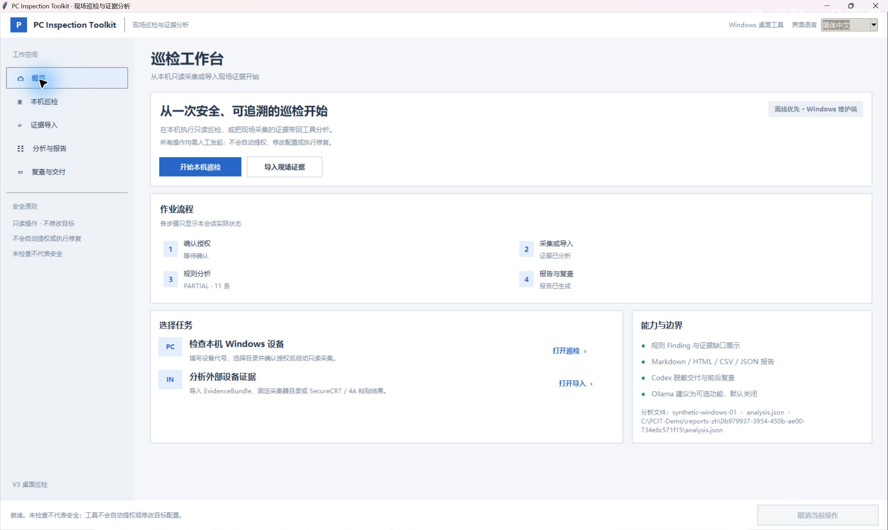
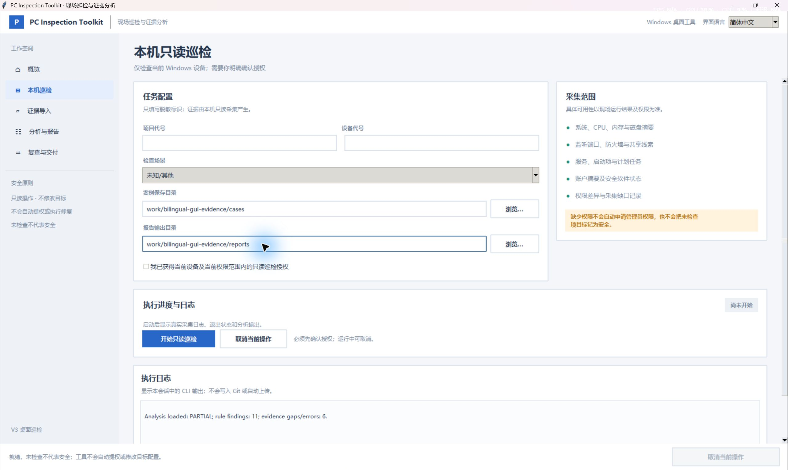
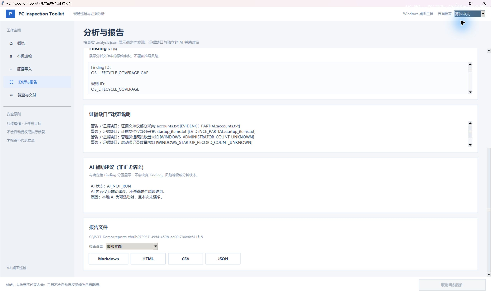
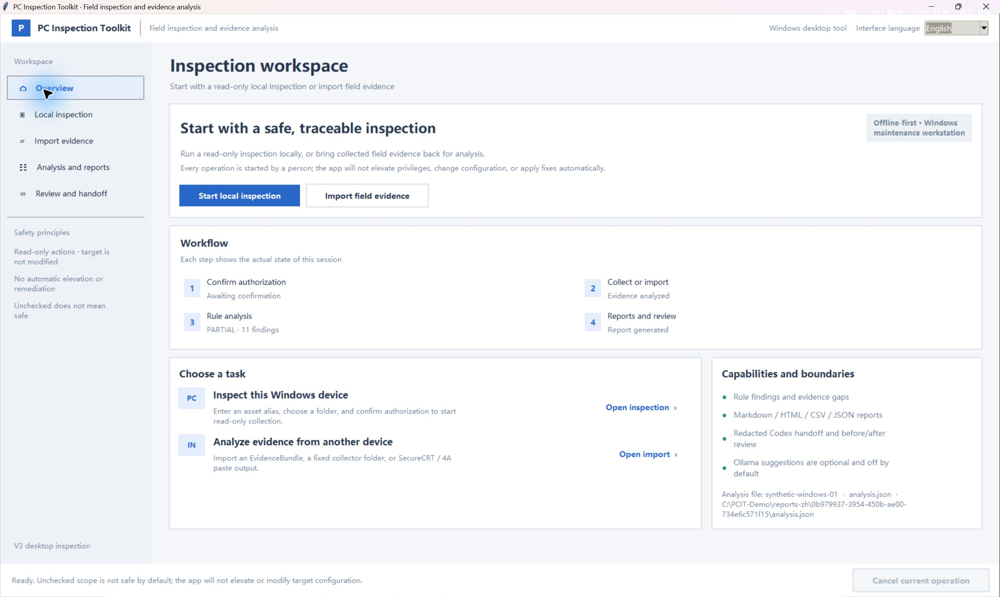
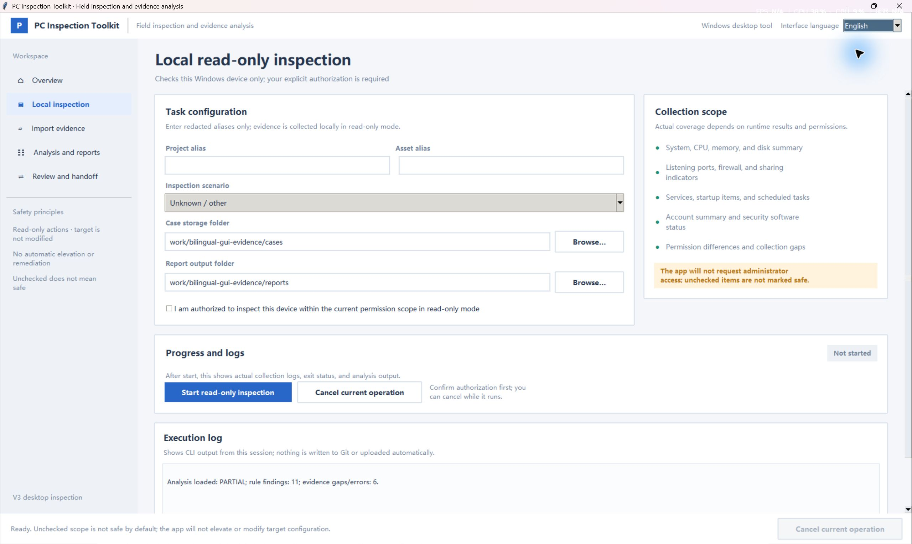
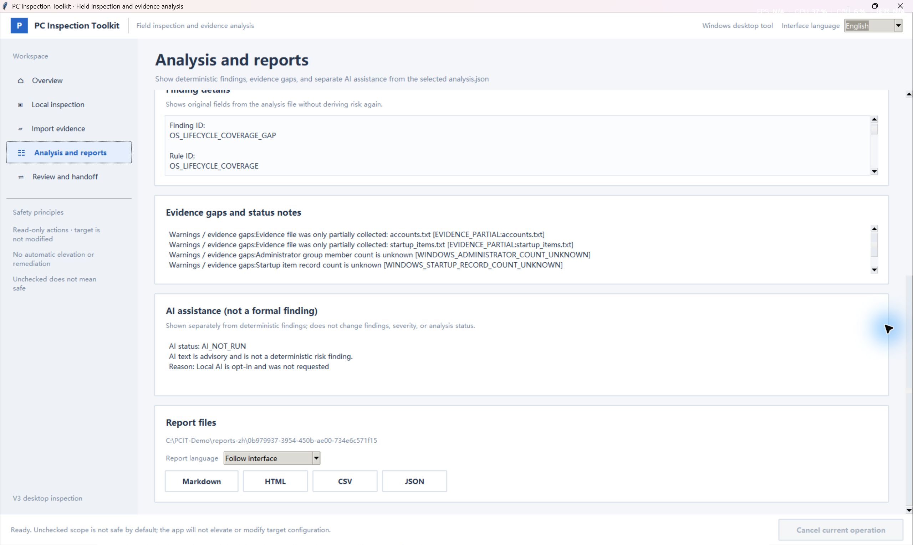

# PC Inspection Toolkit

[English](README.md)

**0.3.0 Preview · 源码预览版**

PC Inspection Toolkit 是供获授权维护工作使用的只读巡检与离线证据分析工具，用于展示采集事实、确定性发现、证据缺口和人工核查步骤。它不会自动整改系统或提权。

桌面 GUI 支持简体中文和 English。默认打开简体中文，并按当前 Windows 用户保存界面语言偏好。

## 预览界面

以下是原有的简体中文 Windows 桌面应用预览图；截图中的路径为合成示例。


## 界面与报告语言

可在顶部选择“简体中文”或“English”。界面语言保存在当前 Windows 用户的应用偏好中。“分析与报告”页面的报告语言可跟随界面，也可单独选择中文或英文；切换界面不会重置该选择。

CLI 不读取 GUI 偏好，默认使用中文。使用 `--lang` 选择 CLI 提示语言，使用 `--report-lang` 单独选择报告语言；省略 `--report-lang` 时报告跟随 `--lang`。Markdown、HTML、CSV 报告文字会随语言切换，机器可读的 `analysis.json` 保持不变。内置 Finding 和整改说明提供中英文；自定义规则、原始证据、路径及非工具自有短语诊断保留来源文本。

以下双语截图来自 Windows 源码 GUI，展示合成路径和示例分析数据。

### 简体中文







### English







可查看[可复现的双语合成报告示例](docs/examples/bilingual/README.md)，其中包含两种语言的报告及封存输入证据包。

## 当前源码能力

- 简体中文和 English Windows 桌面向导：经明确授权后，对当前电脑进行只读采集或导入证据。桌面 GUI 已在 Windows 环境开发和验证；这不代表干净机器或管理员权限验收通过。
- 导入并离线分析通过校验的 Windows 和 POSIX 证据包，明确显示 `OK`、`PARTIAL` 或 `FAILED`。
- POSIX Shell 采集及 SecureCRT / 4A 粘贴导入：仅用于已经授权的会话；工具本身不会连接这些目标。
- 生成 HTML、Markdown、CSV、JSON 报告；支持分析比较和 Codex 脱敏交付。
- 网页版 AI v2 分析包由用户手动导出，结构化回复由用户手动导入；工具不自动发送网页 AI 请求。
- 实验性、主动启用的本地 Ollama 辅助分析，默认关闭。建议与确定性 Findings 隔离，不改变 Finding、严重度或状态；建议质量尚未验收为可靠。

## 平台与验证限制

桌面 GUI 已在 Windows 11 上运行。本预览的启动演练使用 Python 3.12.10 和 Tk 8.6.15；截图使用合成路径，演练没有采集电脑数据。文档要求 Python 3.10 或更高版本及 Tkinter，但并未测试所有 Python/Tk 组合或干净机器安装。真实本机采集、干净 Windows 安装、普通用户与管理员权限矩阵及广泛硬件检查尚未验收。CLI 包含 Windows 与 POSIX 采集分支；这不代表支持所有 Linux 发行版、旧服务器或 macOS 版本。POSIX 采集及粘贴流程要求操作者已获得目标授权。AIX、Windows Server 2008、RHEL 5/6、真实 4A 环境、SMART/RAID 和厂商专用硬件检查仍未验证。工具不能保证发现所有安全或维护问题。

`PARTIAL` 和 `FAILED` 不代表巡检成功。缺失或无法读取的证据会保持未知或不完整，不会被报告为健康。

## 从源码快速开始

克隆公开源码并进入目录：

```powershell
git clone https://github.com/yge-323/pc-inspection-toolkit-public.git pc-inspection-toolkit-public
Set-Location .\pc-inspection-toolkit-public
```

请从你信任的来源准备 Git 和 Python 3.10 或更高版本，并选择包含 Tkinter 的 Python 发行版。GUI 和 CLI 帮助无需额外安装 `pip` 软件包。

Windows 桌面 GUI 需要 Python 3.10 或更高版本及 Tkinter。启动前检查 Python 和 Tkinter：

```powershell
python --version
python -c "import tkinter as tk; root=tk.Tk(); print('Tk', root.tk.call('info','patchlevel')); root.destroy()"
```

启动桌面向导。界面会记住已选语言；打开界面不会启动采集：

```powershell
python -B .\desktop_launcher.py
```

## 安全的首次体验

1. 启动上面的 GUI，浏览**概览**、**本机巡检**和**证据导入**页面。
2. 保持授权确认未勾选。首次体验不要启动采集，也不要选择或导入证据；浏览完成后关闭 GUI。
3. 然后查看高级 CLI 帮助。该命令只显示用法，不会采集或分析证据。

```powershell
python -X utf8 -B .\inspection_cli.py --help
```

在 Windows 上重定向 CLI 输出时，请使用 Python UTF-8 模式（`-X utf8`），并让读取端按 UTF-8 解码。实际环境与结果见[预览演练记录](docs/PREVIEW_WALKTHROUGH.md)。

只有在取得该电脑巡检授权后才可执行本机巡检：

```powershell
python -B .\inspection_cli.py inspect-local `
  --project-alias demo --asset-alias pc1 --use-case office_pc
```

SecureCRT / 4A 粘贴导入可通过 CLI 和桌面证据导入流程使用。POSIX 采集脚本只能在已经授权的会话中运行：

```sh
sh platforms/posix_capture.sh /tmp/ev-host1
sh platforms/posix_paste_export.sh /tmp/ev-host1 > /tmp/paste.txt
```

随后在维护电脑上使用 `inspection_cli.py paste-import` 导入经审核的粘贴文本。不要执行来自不可信证据的命令。

核心离线测试：

```powershell
python -B tests\run_unit_tests.py
```

## AI-Built · Human-Directed

大部分实现代码由 AI 编程工具生成；人类负责需求指引、测试、审核和发布决策。本项目不宣称无人参与或 100% 自动开发。

## 许可证

项目所有者已选择 Apache-2.0。详见 [LICENSE](LICENSE)、[NOTICE](NOTICE) 和[依赖许可证清单](DEPENDENCIES.md)。第三方组件仍适用各自许可证。本源码预览不包含 Python、可选 WinRM 软件包、PyInstaller 或已构建应用。

## 数据与安全

巡检证据、分析文件、报告和日志可能包含敏感信息。请将其保留在本地，分享前逐项检查导出内容；默认不上传真实巡检数据。详见 [SECURITY.md](SECURITY.md)、[CONTRIBUTING.md](CONTRIBUTING.md) 和[依赖许可证清单](DEPENDENCIES.md)。

## 故障排查

- **提示 `No module named tkinter` 或 GUI 启动失败：**请改用包含 Tcl/Tk 的 Python 发行版，然后重新运行上面的 Tkinter 检查。本项目不会替你安装 Python 或 Tkinter。
- **无法运行 `python` 或打开了 Microsoft Store：**先用 `py -3 --version` 检查 Python 启动器是否可用；如果可用，请将上面的 `python` 命令替换为 `py -3`。首次演练不要更改系统设置。
- **Windows 重定向后的 CLI 输出乱码：**使用 `-X utf8` 重新执行，并让读取端按 UTF-8 解码。
- **证据不完整：**将 `PARTIAL` 或 `FAILED` 视为不完整结果，检查界面显示的证据缺口；不要把缺失事实理解为健康。
- **平台或设备类型未列为已验证：**按未验证处理，并使用独立授权且适合该环境的维护流程。

## 源码快照

本仓库由已审核的 97 文件源码快照初始化，快照提交为 `82d1c79ecea2e225dcf25020a45e16b8843672b8`。本仓库不包含原私有仓库的 Git 历史。
